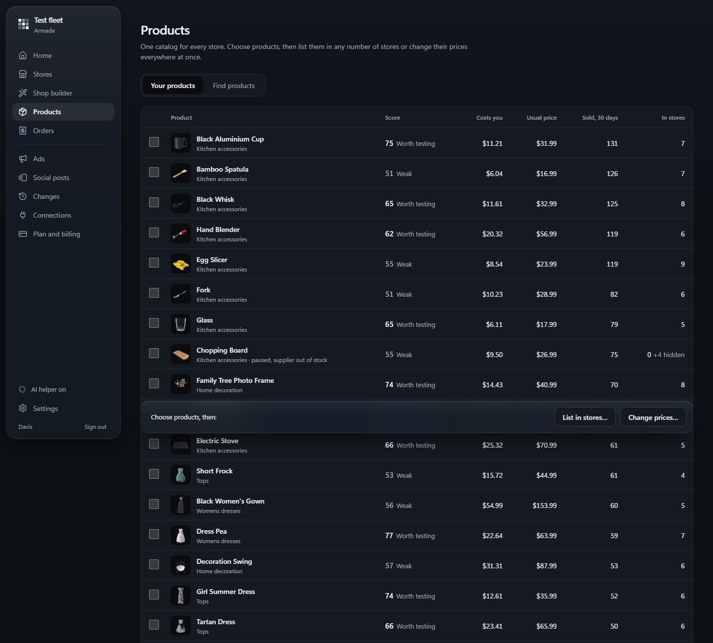

# Armada

A tool for running many online stores from one screen: an AI shop builder, one product catalog scored 1 to 100,
listing and repricing across stores with a preview and undo, one orders inbox, and AI ads and social posts. It
ships with a practice fleet of 24 stores that behaves like real ones without real money.

**Live:** https://armada-pi.vercel.app

**Where it stands:** the practice fleet, the shop builder, CJ Dropshipping search and the eBay and Pinterest
connections work live. Shopify needs its own approved app, which isn't done yet, and checkout and real supplier
orders are built but haven't run with real money.

## How it's built

- **Next.js 16** on Vercel, TypeScript throughout.
- **Postgres (Supabase) with row-level security.** The app signs in as a role that doesn't own the tables, so every
  query is scoped to one workspace (`lib/db`). Migrations are in `supabase/migrations/`.
- **Passkeys first**, with email and password as a second option (scrypt hashes, a lockout after repeated wrong
  tries), and one-time setup links for new devices and teammates.
- **AI jobs in a queue.** Jobs wait in the database; a worker claims them and returns schema-checked JSON. Each
  finished step starts the next one (`lib/shops/pipeline.ts`), and picture jobs wait behind anything a person is
  watching.
- **Supplier API with a shared rate lane.** CJ Dropshipping calls go through a database-backed lane so several
  servers never break the supplier's one-call-a-second limit (`lib/lanes.ts`). Supplier keys are sealed with
  AES-256-GCM (`lib/crypto.ts`).
- **Store connections** through Pipedream Connect (`connectors/`), and Stripe Checkout on the generated storefronts.
- **End-to-end checks** in `scripts/` drive a real browser, signing in with a virtual passkey.

## How it was built

With Claude Code as a pair programmer.

## Running it

Environment, database setup and every command are in [docs/DEVELOPMENT.md](docs/DEVELOPMENT.md).
